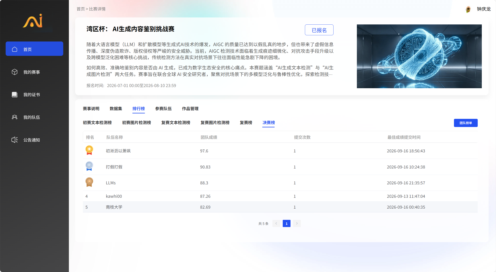

# 湾区杯 · AI 生成内容鉴别挑战赛 — 参赛作品仓库

> 第五届琶洲算法大赛 · 湾区杯 · **南枝大学**参赛队
> 本仓库开源我们的完整技术方案、可复核代码、冻结提交文件与答辩材料。

[](LICENSE)

## 🏁 决赛成绩

**决赛榜第 5 名（共 5 支队伍），团队成绩 82.69。**



| 项目 | 内容 |
|---|---|
| 赛事 | 湾区杯：AI 生成内容鉴别挑战赛（第五届琶洲算法大赛） |
| 赛道 | AI 生成文本检测、AI 生成图片检测 |
| 决赛排名 | **第 5 名**（共 5 支队伍） |
| 决赛团队成绩 | **82.69** |
| 提交次数 | 1 |
| 最佳成绩提交时间 | 2026-09-16 00:40:35 |
| 报名时间 | 2026-07-01 00:00 — 2026-08-10 23:59 |

> 截图取自赛事官网「决赛榜」标签页（页面显示“共 5 条”），原图见
> [`assets/决赛榜-第5名.png`](assets/决赛榜-第5名.png)。

## 双赛道答辩演示

[演示与配套材料](defense/README.md)：14页学术汇报、逐字讲稿、20条问答及实验图表。下载仓库后双击 `defense/index.html`，可离线播放；生成源码与固定版项目skill一并入库，后续通过Git维护。

## 技术方案终版报告（两条赛道合一）

[**湾区杯决赛-南枝大学-技术方案终版报告.md**](湾区杯决赛-南枝大学-技术方案终版报告.md) —— 当前的**权威报告**，覆盖文本与图像两条赛道。

> 入库后完成的三轮修正（含 33 处硬错误与措辞修订、逐条核对依据）已移至 [技术方案报告修订记录](docs/技术方案报告修订记录.md)。

## 复赛成绩（两条赛道）

| 赛道 | 复赛 LB 成绩 | 材料位置 | 状态 |
|---|---|---|---|
| **图像赛道**（AI 生成图像鉴别） | **AUC = 0.918887** | [`image-track/`](image-track/) | ✅ 已上传 |
| **文本赛道**（AI 生成文本鉴别） | **AUC = 0.981301**（交接确认） | [`text-track/`](text-track/) | ✅ 已上传 |

> 两条赛道赛题独立、模型独立、各自提交一个 Docker 镜像。复赛综合分 = e^(4×AUC_image) + e^(4×AUC_text) = **90.1337**（复赛阶段计分口径，与决赛团队成绩 82.69 不同，不可直接比较）。


---

## 图像赛道速览（详见 [`image-track/README.md`](image-track/README.md)）

**方案一句话**：3 个异构骨干（CLIP ViT-H-14 / CLIP ViT-bigG-14 / SigLIP2-so400m-384）× 8 个 LoRA 分量
→ 逐图 ECDF → 三槽 rank 加权 → 叠加尺寸先验。

**三个最值得在答辩里讲的点**：

1. **把"批 rank 融合"改写成"逐图 ECDF"** —— 提交文件用的是 `rank(x)`（在 20000 张里排名，单张算不出来），
   而交付标准要求单张 `POST /predict`。改写后在那 20000 张上**恒等于**全局 rank，
   实测**仅用 10 个冻结 CSV 就能逐图重建提交文件，`spearman = 1.0000000000`**。
2. **槽内多源注入** —— 发现"基底与主分量相关高达 0.9758"（基底几乎就是那一个分量），
   于是改为往主槽**内部**注入两个彼此独立的强分量（相关仅 0.7403）。
3. **尺寸先验**（OOF AUC 0.8247，与模型相关仅 0.146）—— 把它做成**后融合**而不是训练特征，
   避免污染模型；同时**主动披露**它属 shortcut learning。

**交付物**：Docker 镜像 1 个（linux/amd64，7 层，约 19 GB，**运行期零联网**、
非 root 运行、三探针齐全、单张推理 0.31 秒）。

---

## 文本赛道速览（详见 [text-track/README.md](text-track/README.md)）

**方案**：Qwen2.5公开基座加LoRA文本分类，利用教师预测构造软伪标签做目标域自训练。最终14B p4五折为主，7B r3a/r3b两组各五折为辅，权重0.90/0.10，共15个adapter。

2026-10-02已按源码、9个冻结数组和提交CSV修正文档。官方样例AUC实际用于checkpoint和融合权重选择；仓库有多代伪标签脚本，但缺最终完整运行记录。不能将历史候选池数量写成全部非零教师，或声称多种子、异构融合保证提升。

**离线与服务需分别说明**：提交生成代码用replay排名融合，服务v4先平均logit再sigmoid融合。现有数组不能精确重建CSV，冻结online与CSV的Spearman约0.9998697006；高相关不证明AUC不变。最终AUC 0.981301已由交接确认，仓库没有复赛标签及官方截图。

**交付证据边界**：新双层v4镜像约49.66 GiB是团队记录，本次本地只有约44.49 GiB的旧单层v2。GPU平均0.68秒仅来自五条短输入的历史记录；CPU chroot成功路径用缩小随机模型，未完成本次实际Docker验收。代码仍有NaN、缺adapter数量和设备断言等待修风险。

阅读：[技术方案](text-track/docs/01_技术方案报告.md) · [30条问答](text-track/docs/06_答辩要点.md) · [代码事实核对台账](text-track/docs/08_代码事实核对与文档修订.md)。本次只核对文本，图像部分由另一位队员准备。

---

## 目录结构

```
.
├── image-track/
│   ├── README.md                 ← 图像赛道总览（先读这个）
│   ├── WEIGHTS.md                ← 权重清单与 md5（权重不入 git，见说明）
│   ├── docs/
│   │   ├── 01_技术方案报告.md          ← 完整技术方案（含全部实验与踩坑）
│   │   ├── 02_交付包提交说明.md        ← 镜像接口/资源声明/自查清单
│   │   ├── 03_交付说明.md              ← 交付物构成与"修过什么"
│   │   ├── 04_镜像复现偏差说明-回组委会.md
│   │   ├── 05_验证证据一览.md          ← ★ 每个数字的出处与复跑命令
│   │   ├── 06_答辩要点.md              ← ★ 按评审维度组织的答辩材料 + Q&A 预案
│   │   ├── 07_勘误.md                  ← ★ 更正 AS2 报告里三处措辞/算术问题（不改冻结件）
│   │   ├── 08_分量溯源与种子明细.md    ← ★ 8 个分量各是什么、种子控制什么、两个种子家族
│   │   └── 09_基础概念速查.md          ← ★ rank / ECDF / ρ / 阈值 / 精度要求，答辩备查
│   ├── submission/               ← 10 个冻结 CSV（含 0.918887 提交文件）+ README.md 哈希台账
│   ├── code/
│   │   ├── docker_submit/        ← 服务化代码（server/models/fusion + Dockerfile + 构建与复检脚本）
│   │   │   └── requirements-verify.txt  ← 只跑"逐图复现"所需的 4 个小依赖（不装 torch）
│   │   ├── training/             ← 训练脚本（按分量精选）
│   │   ├── probe/                ← 探针脚本（出分量 CSV / 相关性分析）
│   │   └── fusion/               ← 融合与提交文件构建脚本
│   └── evidence/                 ← 真 GPU 验证的原始输出（逐图对照、日志）
└── text-track/
    ├── README.md                 ← 文本赛道总览（先读这个）
    ├── WEIGHTS.md                ← 基座/适配器清单与校验值（权重不入 git）
    ├── docs/
    │   ├── 01_技术方案报告.md            ← 完整技术方案（含全部实验与选型依据）
    │   ├── 02_交付包提交说明.md          ← 镜像接口/资源声明/自查清单
    │   ├── 03_交付说明.md                ← 交付版本、历史修复与残留问题
    │   ├── 04_镜像复现偏差说明-回组委会.md
    │   ├── 05_验证证据一览.md            ← ★ 每个数字的出处与复跑命令
    │   ├── 06_答辩要点.md                ← 按代码核对的项目入门 + 30 条 Q&A
    │   └── 07_复现指南.md                ← 可复核路径及完整复现缺口
    ├── submission/               ← 0.981301 的冻结提交文件
    ├── code/
    │   ├── docker_submit/        ← 服务化代码（server v4 + Dockerfile + 依赖 + healthcheck）
    │   ├── fusion/               ← 融合、权重扫描、提交生成、偏差复算
    │   ├── training/             ← 训练与自训练脚本
    │   ├── features/             ← 似然/隐藏态特征、公共检测器推理
    │   └── verify/               ← 镜像/依赖/权重完整性验证工具
    └── evidence/                 ← 历史成绩 + 冻结数组 + 独立核对结果
```

## 复现最快路径（不需要 GPU、不需要权重、不需要 Docker）

```bash
# ① 图像赛道：必须输出 spearman = 1.0000000000
cd image-track/code/docker_submit
python -m venv .venv && .venv/bin/pip install -r requirements-verify.txt   # 约 1 分钟，4 个小依赖
.venv/bin/python verify_reproduce.py --from-csv

# ② 文本赛道：只用标准库核验冻结数组与CSV，不复算官方AUC
cd ../../..                                  # 回到仓库根
python text-track/evidence/核对工具/verify_frozen.py # 输出实际差异与哈希，现有材料不是逐位重建
```

> ⚠️ **图像赛道需要 numpy ≥ 2**：`gbm.pkl` 是 numpy 2.x 序列化的，numpy 1.x 读不了。
> 用错的版本跑，脚本会**提前拦住并打印解法**，不会给出"看起来对"的错数。
> Windows 把 `.venv/bin/` 换成 `.venv\Scripts\`；中文乱码先 `chcp 65001`。

## 答辩准备入口

**图像赛道**
- **15 分钟演讲怎么排**：`image-track/docs/06_答辩要点.md` §2
- **评委按哪五个维度打分、我们各有什么证据**：同上 §1
- **评委可能怎么追问、怎么答**：同上 §5、§6（含三处必须如实回答的"软肋"）
- **所有数字的出处**：`image-track/docs/05_验证证据一览.md`

**文本赛道**

- [项目机制与实际公式](text-track/docs/01_技术方案报告.md)
- [基础介绍及30条问答](text-track/docs/06_答辩要点.md)
- [每项数字的证据边界](text-track/docs/05_验证证据一览.md)
- [本次修订、待补材料和代码风险](text-track/docs/08_代码事实核对与文档修订.md)

---

## 数据、权重与授权

- 竞赛原始数据（复赛文本/图片、官方样例原文、复赛标签）、模型权重、Docker 镜像**不随仓库分发**；
  权重清单与校验值见 [`image-track/WEIGHTS.md`](image-track/WEIGHTS.md)、[`text-track/WEIGHTS.md`](text-track/WEIGHTS.md)。
- 提交文件只含 `id,score`，不含赛题原文；数据版权归主办方，未经授权不得再分发。
- 训练原始日志已在开源清理时移出仓库，仅保留逐折计时解析
  [`text-track/evidence/训练日志/_耗时解析.json`](text-track/evidence/训练日志/_耗时解析.json)。

## 开源许可与第三方组件

- 本仓库**原创代码与文档**采用 [MIT 许可证](LICENSE) 开源。
- 第三方组件与素材遵循各自许可证，详见 [THIRD_PARTY_NOTICES.md](THIRD_PARTY_NOTICES.md)：
  `defense/assets/` 的字体子集为 SIL OFL 1.1，Motion 为 MIT，Lucide 为 ISC；
  `.agents/skills/guizang-ppt-skill/` 为 **AGPL-3.0**，不属于本仓库 MIT 覆盖范围。
- 仓库内的实验数字均来自源码、冻结数据与原始输出；引用前请先阅读各文档的“证据边界”说明。

## 致谢

感谢第五届琶洲算法大赛 · 湾区杯主办方与评委，以及所有参与数据整理、复核与答辩准备的队友。
